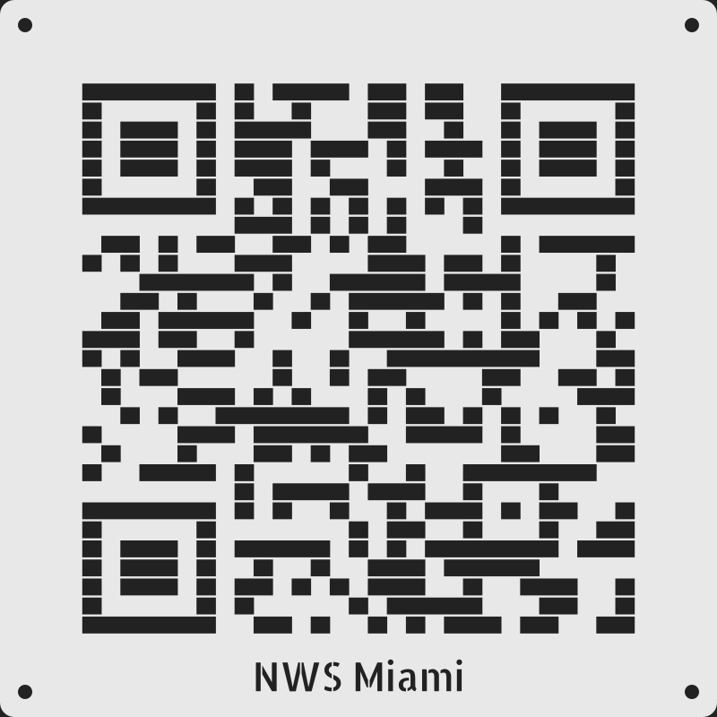
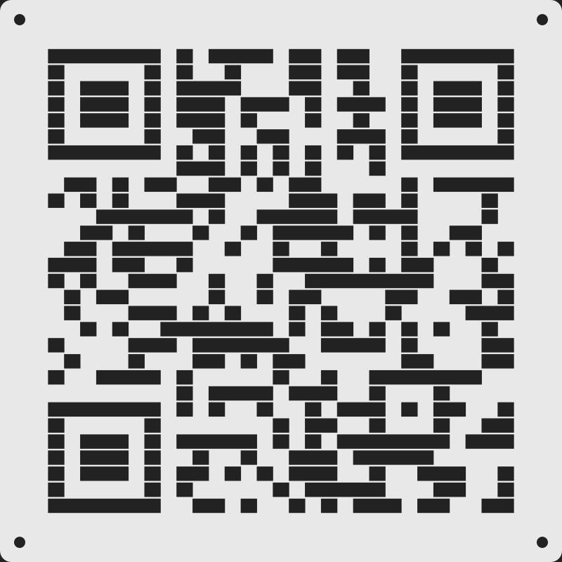

# QR Stencil Pro

**QR Stencil Pro** is a parametric OpenSCAD model that turns any URL into a **3D-printable spray-paint stencil** that holds together in one piece.



QR codes are hard to stencil because they're full of **islands**. These are light areas completely surrounded by dark ones, like the centers of the three corner squares. Cut them out of a plate and they fall out. This model leaves thin **bridges** between rows, so every piece stays attached to the frame. The optional text label is cut in a **stencil font**, so the middles of letters like `o`, `e`, `a` and `p` stay attached too.

QR encoding is done entirely inside OpenSCAD. There's no external generator, no image import and no Python.

## Features

- Any URL (or any text) → printable stencil, with a single connected solid
- Two bridge styles: `rows` (best scanning) or `grid` (stiffest)
- Fixed plate size; the QR auto-sizes to fill it
- Symmetrical layout: equal border on all four sides
- Optional text label in a stencil font, toggled with `show_label`
- Corner holes for tape or pins
- Works with the OpenSCAD Customizer (sliders and dropdowns)

## Quick start

1. Install [OpenSCAD](https://openscad.org/downloads.html) (2021.01 or newer).
2. Download this repo. Keep the `fonts/` folder **next to** `qr_stencil_pro.scad`.
3. Open `qr_stencil_pro.scad` and go to **Window → Customizer**.
4. Set `url` and `label`.
5. Press **F6** (render), then go to **File → Export → STL**.

The console prints the result:

```
QR v3 29x29 | module 5.31 mm | QR 154 mm | border 23 mm | plate 200 mm
```

## Parameters

### Content
| Name | Default | Description |
|-|-|-|
| `url` | `https://www.weather.gov/mfl/` | What the QR encodes |
| `show_label` | `true` | Cut a text label under the QR. Off = the QR grows to fill the plate |
| `label` | `NWS Miami` | The label text |
| `error_correction` | `Q` | `L` / `M` / `Q` / `H`. Higher tolerates more overspray and bridging |
| `mask_pattern` | `0` | 0–7. Try another value if a code scans poorly |

### Size
| Name | Default | Description |
|-|-|-|
| `plate_size` | `200` | Overall plate size, mm (square) |
| `module_mm` | `0` | QR pixel size, mm. `0` = auto (largest that fits) |
| `bridge_mm` | `0.6` | Bridge width, mm. About 10% of module size is the sweet spot |
| `bridge_style` | `rows` | `rows` or `grid` (see below) |
| `thickness` | `0.8` | Plate thickness, mm |

### Label
| Name | Default | Description |
|-|-|-|
| `label_font` | `Allerta Stencil` | `Allerta Stencil` or `Saira Stencil One` (bolder) |
| `label_size` | `8` | Text size, mm |
| `label_gap` | `7.5` | Space above and below the text, mm |

The border on every side is `2 × label_gap + label_size`. Bigger text gives a thicker border and a smaller QR, and the layout stays symmetrical.

### Border
| Name | Default | Description |
|-|-|-|
| `quiet_zone` | `3` | Minimum border in QR modules when there's no label |
| `corner_r` | `4` | Plate corner radius, mm |
| `corner_holes` | `true` | Tape or pin holes |
| `hole_d` | `4` | Hole diameter, mm |

## How the bridges work



Each dark QR pixel is drawn as a square slightly smaller than its slot. The gap left behind is the bridge.

- **`rows`** – pixels are shrunk only on the top and bottom, so horizontal neighbors fuse into long slots. This leaves a continuous strip of plastic between every row, and every light area touches one of those strips. This style gives the fewest bridges and the most reliable scanning.
- **`grid`** – every pixel is its own isolated square hole, with bridges in both directions. It's stiffer, but the extra lines make it harder to scan, so keep `bridge_mm` at 0.4 or less with this style.

The library normally draws the three large corner squares (finder patterns) as solid shapes. Here they're rebuilt pixel by pixel, so the bridges run straight through them and their centers can't fall out.

This works through `qr_custom()` from the scadqr library. The library decides *where* the dark pixels go, and this file supplies *what each pixel looks like* as child geometry.

## Printing

- Print it flat in PLA or PETG. PETG survives more spray sessions.
- A 200 mm plate fills a 200 mm bed, so **turn off skirt and brim**. If your printer can't reach the edges, use `plate_size = 195`.
- 0.6 mm bridges print fine with a 0.4 mm nozzle.

## Spraying

- Tape the stencil flat. A light mist of repositionable spray adhesive on the back helps.
- Spray from straight on, 25–30 cm away, in light passes. Heavy coats wick under the bridges.
- A little paint under the bridges actually *helps* scanning, because it fills in the thin lines.
- Spray onto a light surface. The solid border masks the quiet zone, which is the white margin a QR needs to scan.
- If it won't scan, the paint bled. Use lighter coats before changing the design.

## Tested

Cut patterns were rasterized and decoded with [zxing-cpp](https://github.com/zxing-cpp/zxing-cpp), with blur added to simulate paint bleed. Both bridge styles were tested, with and without the label.

## Thingiverse / MakerWorld Customizer

The QR library is already appended to `qr_stencil_pro.scad`, so the model is a single file. The label fonts are loaded from `fonts/` with `use <...ttf>`. Online customizers may not load bundled fonts, so you may need to pick a stencil font they have installed. If the font is missing, OpenSCAD falls back to a normal font, and the centers of letters like `o` will fall out.

## Credits & licenses

- **This model:** MIT, see [LICENSE](LICENSE)
- **QR encoder:** [scadqr](https://github.com/xypwn/scadqr) by Darwin Schuppan (xypwn) and contributors, MIT, see [THIRD_PARTY.md](THIRD_PARTY.md)
- **Fonts:** [Allerta Stencil](https://fonts.google.com/specimen/Allerta+Stencil) and [Saira Stencil One](https://fonts.google.com/specimen/Saira+Stencil+One), SIL Open Font License 1.1, see `fonts/`
